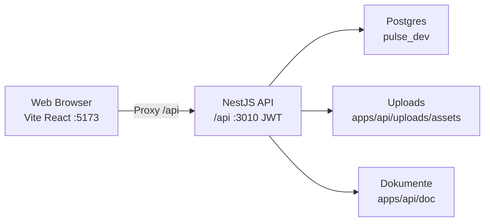
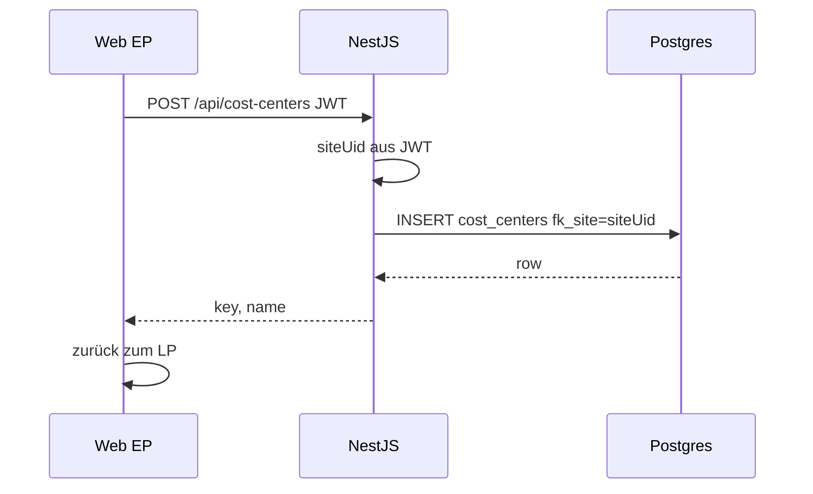
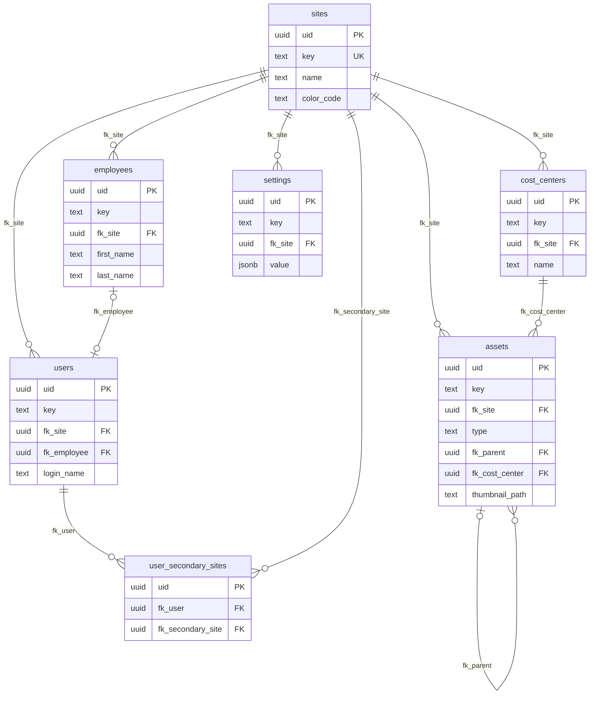

# Pulse – Software-Slice (Ist-Zustand)

Vertikaler Schnitt der heutigen Software: von der Web-Oberfläche über die API bis zur Datenbank. UI-Regeln stehen in [guidelines.md](guidelines.md), Design-Tokens in [DESIGN_pulse.md](DESIGN_pulse.md).

## Rahmen

Pulse ist ein CMMS (Computerized Maintenance Management System) als Monorepo:

| App | Technologie | Stand |
| --- | --- | --- |
| `apps/web` | Vite, React, TypeScript | Login + Fach-Apps inkl. Dokumente |
| `apps/api` | NestJS, `pg` | Auth, CRUD, Uploads, Dokumente |
| `apps/mobile` | Expo (React Native) | Gerüst, kein Login |

Datenbank: Postgres `pulse_dev` auf dem NAS. Migrationen unter `apps/api/db/migrations/`. Kein ORM.

## Schichten

- Der Vite-Dev-Proxy leitet `/api` nach `http://127.0.0.1:3010` weiter.
- Fachzugriff läuft über Bearer-JWT. Passwort-Hashes: argon2.
- Dateien (Asset-Thumbnails) liegen außerhalb der DB unter `apps/api/uploads/assets/` (gitignoriert).
- Dokumente liegen außerhalb der DB unter `apps/api/doc/{siteUid}/assets/{assetUid}/` (gitignoriert, ohne Tabelle).

## Querschnitt: Auth und Mandant

1. Login: `POST /api/auth/login` mit `loginName`, `password`, optional `rememberMe` → JWT + User (ohne `uid`).
2. Session prüfen: `GET /api/auth/me` (Bearer).
3. JWT trägt den Hauptmandanten als `siteUid`.
4. Sichtbar und pflegbar sind Datensätze mit `fk_site` = Hauptmandant des Aufrufers.
   - Ausnahme **Mandanten**: alle Sites.
5. `uid` bleibt intern. Navigation und Anzeige laufen über `key`.
6. Neue Datensätze erhalten `fk_site` des Aufrufers (nicht wählbar).

## Shell

Nach Login Start auf `/sites`. Sidebar aus `apps/web/src/components/layout/nav.ts`:

| Pfad | Label |
| --- | --- |
| `/sites` | Mandanten |
| `/cost-centers` | Kostenstellen |
| `/assets` | Assets |
| `/asset-tree` | Baumstruktur |
| `/documents` | Dokumente |
| `/employees` | Mitarbeiter |
| `/users` | Benutzer |
| `/settings` | Einstellungen |

Jede Fach-App folgt dem Muster **LP** (Liste) und **EP** (Anlegen/Bearbeiten):

- Liste: `/{entity}`
- Anlegen: `/{entity}/new`
- Bearbeiten: `/{entity}/:key/edit`

Ausnahme **Einstellungen**: Reiter statt CRUD; nur Bearbeiten-EP.

Router: `apps/web/src/App.tsx`. Aufbau von Optionsleiste, Tabelle, Formular und Animation: [App Guidelines](guidelines.md#app-guidelines).

## App-Schnitte

### Mandanten

| Schicht | Inhalt |
| --- | --- |
| Route | `/sites`, `/sites/new`, `/sites/:key/edit` |
| LP | Schlüssel, Name, Farbcode |
| EP | Schlüssel, Name, Farbcode (`#RRGGBB`) |
| API | `GET/POST /api/sites`, `GET/PATCH/DELETE /api/sites/:key` |
| Tabelle | `sites` (Wurzel, ohne `fk_site`) |
| Löschen | `409`, solange Referenz in `users`, `user_secondary_sites`, `cost_centers`, `employees`, `assets` oder `settings` |

Alle Sites sind sichtbar und pflegbar. `colorCode` steckt auch in Auth-/User-Antworten (`SiteRef`).

### Kostenstellen

| Schicht | Inhalt |
| --- | --- |
| Route | `/cost-centers`, `/cost-centers/new`, `/cost-centers/:key/edit` |
| LP | Schlüssel, Name |
| EP | Schlüssel, Name; Mandant nur lesbar |
| API | `GET/POST /api/cost-centers`, `GET/PATCH/DELETE /api/cost-centers/:key` |
| Tabelle | `cost_centers` |
| Löschen | `409`, solange `assets.fk_cost_center` darauf zeigt |

Scope: nur `fk_site` = Hauptmandant.

### Assets

| Schicht | Inhalt |
| --- | --- |
| Route | `/assets`, `/assets/new`, `/assets/:key/edit` |
| LP | Bild, Schlüssel, Typ (Art), Typ (Eltern), Kostenstelle, Seriennummer, Hersteller, Dokumente (Icon + Anzahl) |
| EP | Schlüssel, Art, Seriennummer, Hersteller, Thumbnail; Eltern-Asset, Kostenstelle; Dokumente (Liste + Drop-Zone, nur Bearbeiten); Mandant nur lesbar; Aktion Dokumente |
| API | `GET/POST /api/assets`, `GET/PATCH/DELETE /api/assets/:key`, Thumbnail `POST/DELETE /api/assets/:key/thumbnail`, Auslieferung `GET /api/uploads/assets/:filename` |
| Tabelle | `assets` (`type`, `fk_parent`, `fk_cost_center`, `thumbnail_path`, …) |
| Löschen | `409`, solange Kinder (`fk_parent`) existieren; Thumbnail und Dokumentenverzeichnis werden mit entfernt |

Arten (DB englisch): `location` → `building` → `area` → `assembly` → `maintenance_object`. Eltern darf gleiche oder tiefere Stufe hosten. Standort darf Wurzel sein; andere Arten brauchen ein Eltern-Asset. Scope: eigener Hauptmandant.

### Dokumente

| Schicht | Inhalt |
| --- | --- |
| Route | `/documents`, `/documents/assets/:key` |
| LP | Name, Art, Größe, Datum, Bezug; kein EP, kein Neu |
| API | `GET /api/documents`, `GET /api/documents/counts`, `POST/GET/DELETE /api/documents/assets/:key[/:filename]` |
| Speicher | `apps/api/doc/{siteUid}/assets/{assetUid}/` (keine Tabelle) |
| Scope | nur App `assets`, eigener Hauptmandant |

Hochladen nur unter `/documents/assets/:key`. Globale Liste öffnet und löscht.

### Mitarbeiter

| Schicht | Inhalt |
| --- | --- |
| Route | `/employees`, `/employees/new`, `/employees/:key/edit` |
| LP | Schlüssel, Name (Vorname Nachname) |
| EP | Schlüssel, Vorname, Nachname; Mandant nur lesbar |
| API | `GET/POST /api/employees`, `GET/PATCH/DELETE /api/employees/:key` |
| Tabelle | `employees` |
| Löschen | `409`, solange `users.fk_employee` darauf zeigt |

Scope: nur `fk_site` = Hauptmandant.

### Benutzer

| Schicht | Inhalt |
| --- | --- |
| Route | `/users`, `/users/new`, `/users/:key/edit` |
| LP | Schlüssel, Login, Name, Nebenmandanten, Mitarbeiter |
| EP | Schlüssel, Login, Vorname, Nachname, Passwort (nur Anlegen bzw. optional ändern); Hauptmandant fix; Nebenmandanten; optional ein Mitarbeiter |
| API | `GET/POST /api/users`, `GET/PATCH/DELETE /api/users/:key`, Optionen `GET /api/users/site-options`, `GET /api/users/employee-options` |
| Tabellen | `users`, `user_secondary_sites` |
| Löschen | eigener Account verboten; Mitarbeiter-Zuordnung 1:1 (`UNIQUE` auf `users.fk_employee`) |

Scope: nur Benutzer mit `users.fk_site` = Hauptmandant. Nebenmandanten erweitern den Zugang, sind aber nicht Default für neue Records.

### Einstellungen

| Schicht | Inhalt |
| --- | --- |
| Route | `/settings`, `/settings/:key/edit` (`?category=general\|lists\|orders`) |
| LP | Reiter Allgemein / Listen / Aufträge; Spalten Schlüssel, Name, Beschreibung, Wert; kein Neu/Löschen |
| EP | Schlüssel, Name, Beschreibung, Erläuterung nur lesbar; Wert editierbar; Mandant nur lesbar |
| API | `GET /api/settings`, `GET/PATCH /api/settings/:key` |
| Tabelle | `settings` (`value` jsonb); Metadaten im Katalog `setting-catalog.ts` |
| Scope | Mandantenbezogene Werte: Hauptmandant; globale Werte: `fk_site` NULL |

Erster Parameter: `DWH` (Allgemein, site, Zahl, Default 8). Ohne gespeicherte Zeile gilt der Katalog-Default.

## Beispiel-Durchlauf

Benutzer legt eine Kostenstelle an:

## Datenmodell

Konsistenzregeln und Constraints: [Datenkonsistenz](guidelines.md#datenkonsistenz).

## Bewusst nicht im Schnitt

- Mobile-Login
- Site-Umschalter
- Aufträge (Mandant vom Asset)
- Weitere CMMS-Fachmodule
- Shared-Packages

Siehe [Nächste Schritte](guidelines.md#nächste-schritte-nur-nach-absprache) in den Guidelines.
